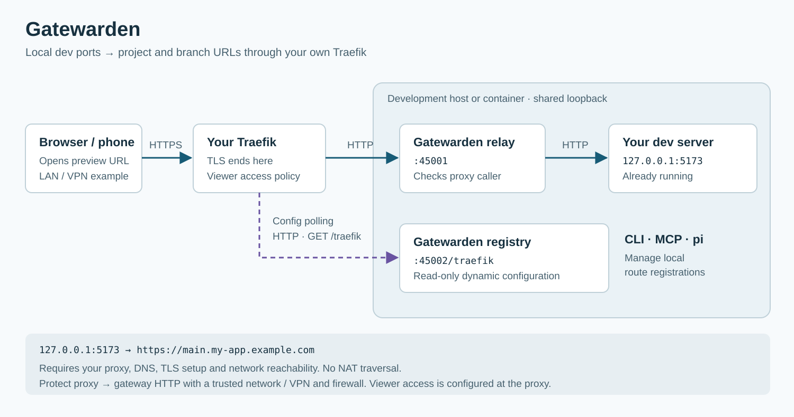

# Gatewarden


Predictable HTTPS URLs for local development servers, through your own reverse proxy.

Register a local port and share an address based on the project and branch:

```text
127.0.0.1:5173 → https://main.my-app.example.com
```

Gatewarden is proxy-agnostic: its core manages routes, names and local forwarding,
and a `ProxyAdapter` connects it to your reverse proxy. The package ships with a
Traefik adapter. Use the CLI yourself, or let an AI agent manage the same routes
through MCP. Your Vite, Next.js, Nuxt or other HTTP server keeps running as usual.

**You provide the proxy, DNS, TLS configuration and a network path to the
development machine.** The instructions below use the included Traefik v2/v3
adapter. Another proxy can be integrated by implementing and packaging a
`ProxyAdapter`; adapters are not installed by changing a configuration value.
Gatewarden does not establish an outbound tunnel or provide NAT traversal.

[Setup](docs/setup.md) ·
[Traefik configuration](docs/traefik.md) ·
[Security policy](https://github.com/malarstrom-it/gatewarden/security/policy) ·
[Agent skill](skills/gatewarden/SKILL.md)

## A route after one-time setup

With a dev server already listening on port 5173:

```sh
gatewarden register --project my-app --branch main --port 5173
```

Example response for a gateway configured with the zone `example.com`:

```text
registered main.my-app.example.com -> 127.0.0.1:5173 (dev server is up)
url: https://main.my-app.example.com
```

Use the URL returned by the command. When finished, remove the route:

```sh
gatewarden unregister --project my-app --branch main
```

## How it works

The diagram shows the bundled Traefik integration. The core uses a proxy adapter
for discovery, configuration rendering, wiring instructions and optional route
verification. See the [proxy adapter guide](docs/adapters.md).



Traefik polls the registry for dynamic configuration and sends application
requests to the relay. The relay looks up the registered port and forwards to
`127.0.0.1`. Gatewarden and the dev server must share the same loopback network
namespace: for a container deployment, that normally means the same container.

TLS terminates at Traefik. The proxy-to-gateway connections use HTTP. Keep that
path on a trusted network or protect it with a VPN and restrictive firewall rules.

## Requirements for the included Traefik adapter

- Node.js 20.11 or later, as declared by the current package. Prefer a maintained Node release.
- An existing Traefik v2/v3 proxy with DNS and TLS configured for your dev names.
- Network reachability from Traefik to the registry and relay, normally ports 45002 and 45001.
- The proxy's source address in the gateway's trust configuration.

The development server is started separately. Gatewarden manages routes and
forwarding, rather than the dev-server process.

## Quick start

**1. Install** on the machine or in the container that runs your dev servers:

```sh
npm install -g @malarstrom/gatewarden
```

**2. Configure the gateway** with the setup wizard:

```sh
gatewarden setup
```

**3. Wire the proxy.** Apply the HTTP-provider snippet printed by setup to
Traefik's **static** configuration, then restart Traefik. Setup cannot change
the remote proxy for you. Configure the trust list and, if used, shared-secret
headers on both paths. See the [Traefik guide](docs/traefik.md).

**4. Start your dev server separately**, then register its local port:

```sh
gatewarden register --project my-app --branch main --port 5173
```

**5. Check the installation** with `gatewarden doctor`, then open the returned
URL from the intended client. Use the returned URL verbatim.

**6. Remove the route** when finished:

```sh
gatewarden unregister --project my-app --branch main
```

Installation starts no daemon. Commands that need it start the daemon on demand.
For project-local installation, platform paths and installation-script behavior,
see [setup](docs/setup.md) and [install scripts](docs/install-scripts.md).

## Security and exposure

**A registered app can be reached by everyone your proxy permits.** Configure
viewer authentication and access restrictions at the proxy or application.
The gateway's source-CIDR checks and optional shared secret guard the proxy-to-gateway
connection; they do not sign a person in to the preview.

The registry has no remote route-write API. The relay only targets registered
ports on loopback. Both listeners bind to network interfaces; use a restrictive
firewall and review the effective trust list. In the current implementation,
configuration loading also adds detected IPv6 network prefixes to that list.

A route reported as `up` passed a local port probe. This does not establish that
DNS, certificates, proxy routing or the application work from another device.

For limits, supported versions and private vulnerability reports, read
[security policy](https://github.com/malarstrom-it/gatewarden/security/policy).

## Choosing a tool

See the [deployment comparison](docs/alternatives.md) for architectural
differences, operator responsibilities and source references.

| Your need | Consider |
| --- | --- |
| Project/branch routes through your own proxy, managed by CLI or agent; Traefik adapter included | Gatewarden |
| One or two stable routes with minimal extra tooling | Manual Traefik configuration and a reachable backend |
| Reach localhost through NAT without building a direct proxy path | [ngrok](https://ngrok.com/docs/gateway/endpoints/agent-endpoints) or [localtunnel](https://github.com/localtunnel/localtunnel) |
| An outbound connector into Cloudflare's network | [Cloudflare Tunnel](https://developers.cloudflare.com/cloudflare-one/networks/connectors/cloudflare-tunnel/) |
| A self-hosted tunnel/reverse proxy with broader protocol support | [frp](https://github.com/fatedier/frp) |
| Private sharing within an existing tailnet | [Tailscale Serve](https://tailscale.com/docs/reference/tailscale-cli/serve) |

These tools use different network and operational models. Self-hosting and HTTPS
alone do not establish a comparative security ranking.

## For AI agents

The `gatewarden-mcp` binary provides a stdio MCP server. Configure the executable
and working directory using your client's supported format.

| Tool | Input | Output |
| --- | --- | --- |
| `publish_dev_server` | `{ port, project?, branch?, label? }` | `{ url, fqdn, project, branch, port, state }` |
| `remove_dev_server` | `{ project, branch }` | `{ removed, fqdn? }` |
| `list_dev_servers` | `{}` | `{ routes: [{ project, branch, port, fqdn, url, state }] }` |
| `dev_gateway_status` | `{}` | `{ daemon, proxy, config, reachable }` |

For publishing, `project` and `branch` can be inferred from the working directory.
Return the tool's URL verbatim, and remove the route when the dev server is stopped.
MCP tool calls can start the daemon, including list and status calls.

The package also ships a [Gatewarden agent skill](skills/gatewarden/SKILL.md)
and a pi extension with a `/routes` view. Install or activate integrations using
your client's supported
mechanism; merely installing the npm package does not configure every client.

## CLI reference

| Command | Purpose |
| --- | --- |
| `gatewarden register --project p --branch b --port N` | Register or update a route |
| `gatewarden unregister --project p --branch b` | Remove a route |
| `gatewarden list` | List registrations; `--json` returns structured output |
| `gatewarden status` | Inspect daemon and installation state |
| `gatewarden config [--write]` | Show configuration or write the configuration file |
| `gatewarden setup` | Configure the gateway interactively |
| `gatewarden start` | Start the daemon |
| `gatewarden stop` | Stop the daemon |
| `gatewarden doctor [--strict]` | Diagnose installation and connectivity |
| `gatewarden install-service [--no-enable]` | Install the platform service |
| `gatewarden version` | Print the package version |

Global options include `--config`, `--state-dir`, `--json`, `--version` and `--help`.
CLI read commands (`list`, `status`, `config`, `doctor`) do not start the daemon.
See the [setup guide](docs/setup.md) for migration, platform service behavior
and uninstalling the package.

## The proxy adapter

The core delegates proxy discovery, configuration rendering and wiring to
`ProxyAdapter`. Traefik v2/v3 is the bundled adapter; another proxy needs an
implemented adapter included in the package. The [adapter guide](docs/adapters.md)
describes the contract and how the catalog selects one.

## Documentation and project status

- [Setup and configuration](docs/setup.md)
- [Traefik integration](docs/traefik.md)
- [Diagnostics](docs/healthcheck.md) and [troubleshooting](docs/troubleshooting.md)
- [Source and contribution guide](https://github.com/malarstrom-it/gatewarden)
- [Changelog](CHANGELOG.md)

Gatewarden is an early 0.1.x project. Check the security policy for supported
versions. Reports about vulnerabilities belong in the private reporting channels
listed there; ordinary bugs and feature requests belong in
[GitHub Issues](https://github.com/malarstrom-it/gatewarden/issues).

This is a one-person project. For ordinary support, write to npm@malarstrom.se
with the command, expected result and relevant diagnostics. Remove secrets before
sharing command output. Security reports go privately to the same address using
the process in the security policy.

MIT licensed. See [LICENSE](LICENSE).
