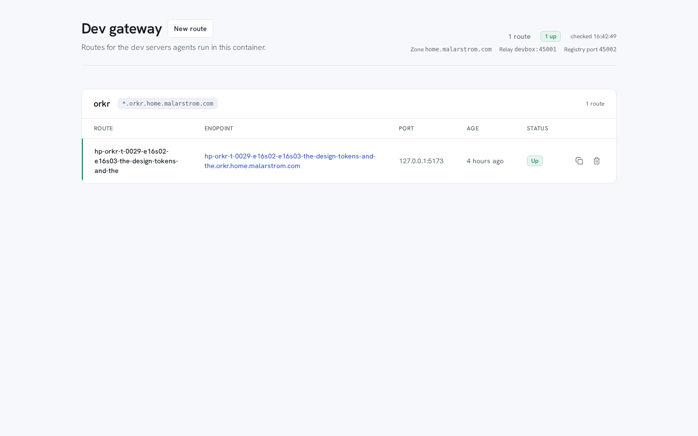
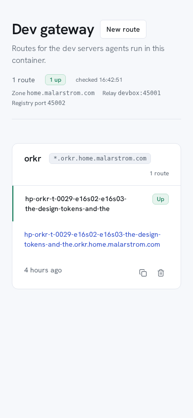

# Traefik dev gateway — container side

Exposes the dev servers that AI agents run **inside this container** on the user's LAN through the
user's Traefik.

* A **registry** serves the Traefik dynamic-configuration document (HTTP provider) and an index page
  listing everything that is currently registered.
* A **relay** forwards a request to the right dev server on `127.0.0.1:<port>`, including WebSocket
  upgrades (Vite HMR, Next.js) and `X-Forwarded-*` headers untouched.
* A **CLI** (`traefik-dev`) registers and unregisters a dev server and starts the daemon if it is not
  running.

The user's Traefik is **not** touched by this repository. The one change the user makes is the
static configuration patch in [`docs/traefik-wiring.md`](docs/traefik-wiring.md).

## How it fits together

```
user laptop ──https://<branch>.<project>.home.malarstrom.com──▶ Traefik (host, 10.10.1.50)
                                                                    │  HTTP provider polls /traefik
                                                                    ▼
   this container ("devbox" on the Docker network "private", 172.16.2.13)
     ├─ registry :45002  ── /traefik  (dynamic configuration document)
     │                ── /         (HTML index: what is running)
     │                ── /api/registrations
     │                ── /api/routes  (the route list as an HTML fragment)
     │                ── /index.css, /index.js, /fonts/…  (the page's own assets)
     │                ── DELETE /api/registrations/<project>/<branch>
     │                ── /healthz
     └─ relay    :45001  ── dispatches on the X-Dev-Target header to 127.0.0.1:<dev port>
```

One registration = one Traefik router + one service + one dispatch middleware, added and removed
atomically. A section without entries is **omitted** from the document (never rendered as `{}`):
Traefik's decoder rejects an empty map. The FQDN is `<branch>.<project>.home.malarstrom.com`; the branch label is a DNS-safe
slug (GitLab `CI_COMMIT_REF_SLUG` convention).

## What an agent needs to run

```bash
traefik-dev register --project <project> --branch <branch> --port <dev port>
# → registered feature-login.alpha.home.malarstrom.com -> 127.0.0.1:5173
#   url: https://feature-login.alpha.home.malarstrom.com

traefik-dev unregister --project <project> --branch <branch>
```

`register` writes the registration to the persistent state and **starts the daemon if it is not
running**, so the first `register` after a container restart brings the whole gateway back up.
Nothing else has to be started by hand.

Other commands:

| Command | What it does |
| --- | --- |
| `traefik-dev register --project p --branch b --port N [--label text]` | register (or update the port of) a dev server |
| `traefik-dev unregister --project p --branch b` | remove the registration |
| `traefik-dev list` | list the registrations (`--json` for scripts) |
| `traefik-dev status` | daemon state, ports, configuration summary |
| `traefik-dev config [--write]` | show the configuration and every key (`--write` writes the file) |

Global options: `--config <path>`, `--state-dir <path>`, `--json`.

## The index page

`https://index.home.malarstrom.com` is a live console of the dev servers agents publish through
the gateway. It is server rendered by the registry, has no framework, no runtime dependency and no
runtime build, and asks no third party for anything: the typeface is **self hosted** from
`src/assets/fonts/` (Hanken Grotesk, under the SIL Open Font License, the licence next to the
file). A CDN font request would leak every visit on this private network.



The page is grouped by project, because a project is the unit the proxy certificate is issued for;
the certificate that covers the project's routes is named in the group header. Every route is one
row of a table: the branch, the public host name, the port the dev server listens on inside the
container, how long ago it was registered, whether anything answers there, and the two actions
that matter.

| Behaviour | How it works |
| --- | --- |
| Live without a reload | the page polls `GET /api/registrations` every 4 s and patches the rows that changed in place; no flashing, no scroll jumps, and the focus stays on the button you are about to click |
| Make a route by hand | the **New route** panel in the masthead creates a route without an agent: project, branch and port, the port the dev server listens on inside this container. The panel is inline (never a modal), Escape closes it and gives the focus back, and a route made by hand is an ordinary route from the first second — its own badge, its own band, its own Remove button |
| The page does not move under your hands | while a band is open under a route — a confirmation, a failure, a "copied" — a background refresh is **held** until the band closes, and the focus is never dropped on the document body |
| Honest state | `Up` / `Down` comes from the gateway's own probe of the dev server's port; a filled badge against an outlined one, and a solid edge against a broken one, so the two are told apart by shape and not only by colour. A change is announced once, in a live region |
| Open a route | the host name is a link, and the copy button puts the long URL on the clipboard |
| Clear a route | the bin button asks first in a band under the route; `Escape` cancels it and the route is left alone. The band then says what happened |
| Everything is said in the row it is about | the confirmation, a failed removal and "Copied …" all appear in that route's own band, where the eye already is — not in a line at the top of the page |
| Outcomes fade, questions do not | "Copied …" and "Removed …" fade out on their own after four seconds; the removal confirmation and a failure stay until the user acts — a question waiting for an answer, and a message that says what to do instead, must not vanish |
| Nothing running | the empty state names the one command that publishes something, with a copy button |
| Freshness | the masthead shows when the data was last checked |

The page is responsive down to a phone (below 768 px each route becomes a stacked block —
branch and state, then the host name, then the age and the two actions), has a
visible keyboard focus ring, keeps its text contrast at 4.5:1 or better, and
drops its motion when the reader asks for reduced motion.



### Creating a route by hand

The client can create a route from the page, without an agent:

```
POST /api/registrations
X-Gateway-UI: 1
Content-Type: application/json
{ "project": "my-app", "branch": "feature", "port": 5173 }
```

| Answer | When |
| --- | --- |
| `201` | the route was created; the body is the registration (its id and its FQDN) |
| `400` | the route was refused; the body says why (`{ "error": …, "field": … }`) and the page says it next to the field it was wrong about |
| `403` | the `X-Gateway-UI` header was missing — the same CSRF guard the removal uses |
| `409` | that project and branch already has a route; the body names the route that is there |

The rules are the CLI's rules, in one place: the project and branch are
slugged by `slugify()` (`src/util/slug.ts`), the port must be an integer
between 1 and 65535, and it must not be a port the gateway itself listens
on. The registry writes the **same state file the CLI writes**, through the
store's own `upsert`, so a route made in the page is a route the CLI lists
and the CLI can remove.

**One difference from the CLI, on purpose.** `traefik-dev register`
*updates* an existing project+branch in place — that is what an agent wants
when it restarts a dev server on another port. The page's create never
does that: a route the client can see is never silently changed behind
their back, so it answers `409` and names the route that already exists.

### The styles

The page is styled with **Tailwind CSS** over a **shadcn/ui** token set, the same handful of
roles a shadcn project uses (`--color-background`, `--color-foreground`, `--color-primary`,
`--color-muted`, `--color-border`, `--color-ring`) filled with this page's palette. The
components that shadcn ships as React — the button, the badge, the card, the table — are here as
plain classes in `@layer components`, because the page is server rendered HTML and must stay free
of a runtime dependency.

Tailwind is compiled **ahead of time** and the compiled stylesheet is committed; the daemon
serves it as one static file and compiles nothing at runtime:

    npm ci            # installs the pinned toolchain (tailwindcss and @tailwindcss/cli, 4.3.3)
    npm run build:css # tailwindcss -i src/assets/index.src.css -o src/assets/index.css

`src/assets/index.src.css` is the source; `src/assets/index.css` is the compiled file the
registry serves. The build uses the **local** binary from `node_modules/.bin`, so it never
reaches the network and never picks up a different Tailwind version than the committed artifact
was built with.

**When the markup in `src/index-page.ts` gains or loses a utility class, the stylesheet has to be
compiled again** — a missing class is silently unstyled until `npm run build:css` has run. The
test `test/build-css.test.ts` compiles the source into a temporary file and compares it with the
committed stylesheet, so a stale artifact fails the suite instead of the page.

`tools/screenshot.py` and `tools/interaction-check.py` drive the page with Playwright; they are
review tools, not part of the gateway, and the daemon never loads them.

## Removing a registration by hand

The index page has a **Remove** button on every row. The user clicks it, confirms, and the
registration is gone: the router, service and middleware disappear from the dynamic configuration
document, and Traefik drops the route on its next poll (≈5 s).

This exists for the case where an agent forgot to unregister a dev server it stopped: the user can
clean the index up without needing the CLI. The CLI is unchanged and remains the normal way to
unregister.

The endpoint behind the button:

```
DELETE /api/registrations/<project-slug>/<branch-slug>
X-Gateway-UI: 1
X-Registry-Secret: <secret>     # only when a secret is configured
```

* `204` on success, `404` when the registration does not exist.
* The slugs are the ones in the URL (`<branch>.<project>.<zone>`), which is also the id the store
  keys on and the value of the `X-Dev-Target` dispatch header.
* `X-Gateway-UI: 1` is a **CSRF guard**. A custom header is never sent by a plain form submission
  or by a "simple" cross-origin request, so sending it forces a CORS preflight — and the registry
  sends no CORS headers, so a page on another origin can never trigger a deletion. Only the index
  page itself (same origin) can.
* When a `secret` is configured, `X-Registry-Secret` must match it, the same convention the http
  provider uses for `/traefik`. With no secret configured (the user's current setup), the UI header
  is the only guard.
* Every removal is logged in `~/.traefik-dev/daemon.log` with project, branch and source address.

Trust boundary: anyone who can reach the index URL can remove a registration. The index is only
reachable from networks that can route the private address `10.10.1.50`, and the Traefik dashboard
next to it is already unauthenticated. A `secret` in `~/.traefik-dev/config.json` raises the bar.

## URLs the user can click

| URL | What it shows |
| --- | --- |
| `https://<branch>.<project>.home.malarstrom.com` | the registered dev server |
| `https://index.home.malarstrom.com` | the index: every registration, its URL, port and whether it answers |

## The `traefik-dev-gateway` pi skill

A **pi skill** in [`skills/traefik-dev-gateway/`](skills/traefik-dev-gateway/) teaches any pi agent
— in this project or in any other — that a dev server started inside this container can be
published on the user's LAN. The skill is advertised to pi by name and description, and its body is
loaded only when a task matches ("start a dev server and give me a URL").

Install it globally by adding the skills directory to the **user** settings
(`~/.pi/agent/settings.json`):

```json
"skills": ["~/projects/traefik-api/skills"]
```

Then, in any project, the agent registers a dev server with the same command as above and hands the
user `https://<branch>.<project>.home.malarstrom.com`.

The skill body is short on purpose; the depth lives in
[`references/troubleshooting.md`](skills/traefik-dev-gateway/references/troubleshooting.md) and
[`references/architecture.md`](skills/traefik-dev-gateway/references/architecture.md).

## Installation

Nothing to install: Node 24 (native TypeScript execution) is enough, and there are **no runtime
dependencies**.

```bash
git clone <this repo> ~/projects/traefik-api
cd ~/projects/traefik-api
npm install          # dev-only tooling (typescript, @types/node)
```

The commands are plain scripts:

```bash
node bin/traefik-dev.js  register --project alpha --branch main --port 5173
node bin/traefik-devd.js                        # run the daemon in the foreground
```

`npm link` (or a symlink into `~/.local/bin`) makes `traefik-dev` available on the `PATH`.

## State directory

Everything lives in `~/.traefik-dev/` (a mounted volume, so it survives container restarts):

| File | Content |
| --- | --- |
| `registrations.json` | the registrations (the single source of truth, written atomically) |
| `config.json` | the configuration |
| `daemon.pid` | pid of the running daemon |
| `daemon.log` | daemon log (rotated at 5 MB, 3 files kept) |

## Configuration

`~/.traefik-dev/config.json` (create it with `traefik-dev config --write`). Every key:

| Key | Default | Meaning |
| --- | --- | --- |
| `registryPort` | `45002` | port the registry binds on `0.0.0.0` |
| `relayPort` | `45001` | port the relay binds on `0.0.0.0` |
| `advertisedIp` | detected (`172.16.2.13`) | IP this container has on the Docker network (used in the status output) |
| `advertisedHost` | `devbox` | host name the Traefik container reaches this container under; `devbox` is the compose service name and resolves on the `private` network, so it survives an IP change |
| `zone` | `home.malarstrom.com` | DNS zone the FQDNs are built from |
| `indexHost` | `index.home.malarstrom.com` | host name of the index router |
| `entryPoints` | `["websecure"]` | Traefik entryPoints the routers attach to |
| `certResolver` | `cloudflare` | ACME resolver used for the `tls` block (empty = no `tls` block) |
| `tlsMode` | `wildcard` | `wildcard` = one certificate per project (`*.<project>.<zone>`), `fqdn` = one per branch |
| `securityHeaders` | `false` | also apply the user's `default-security-headers@file` middleware |
| `compressMiddleware` | `false` | also apply the user's `compress@file` middleware |
| `middlewareProvider` | `file` | provider that owns those shared middlewares |
| `allowedCidrs` | `["172.16.2.0/24", "127.0.0.1/32", "::1/128"]` | sources allowed to use the `X-Dev-Target` header; the container's own IPv6 prefix is added automatically |
| `secret` | `""` | optional shared secret (checked on the registry document and the relay dispatch) |
| `stateDir` | `~/.traefik-dev` | state, pidfile and logs |
| `documentFormat` | `yaml` | `yaml` or `json` for the dynamic configuration document |
| `logMaxBytes` | `5242880` | rotate the log file above this size |
| `logKeep` | `3` | rotated log files to keep |

## Self-healing

* `traefik-dev register` probes `/healthz` and the pidfile; if the daemon is not running it starts it
  detached and waits until it answers.
* The daemon supervises two workers (registry, relay). A worker that dies is respawned; the other
  listener keeps serving.
* Registrations live in a file, so nothing is lost when a listener restarts.

Optional host-side autostart (not applied by this repository — the container entrypoint
`/usr/local/bin/devbox-entrypoint` is root-owned and not writable by the `node` user):

```bash
# run the gateway when the container starts
docker exec <container> sh -lc 'nohup node /home/node/projects/traefik-api/bin/traefik-devd.js >> /home/node/.traefik-dev/daemon.log 2>&1 &'
```

Lazy start makes this optional: the first `traefik-dev register` after a restart is enough.

## Tests

```bash
npm test          # node --test test/*.test.ts
npm run typecheck # tsc --noEmit
```

Covered: slug and FQDN derivation, the registration lifecycle and its atomicity, idempotent
re-registration, the rendered document parsing back to the same object, relay dispatch, `404`/`403`/
`502` paths, `X-Forwarded-*` passthrough, streaming and SSE, the WebSocket upgrade, the registry
endpoints, the index page (empty state, status indicator, copy affordance, registration ids, the
assets it serves and that it asks nothing from a third party), the CLI, `ensureDaemon()` starting
the daemon, the daemon restarting after a kill and the daemon respawning a dead worker.
